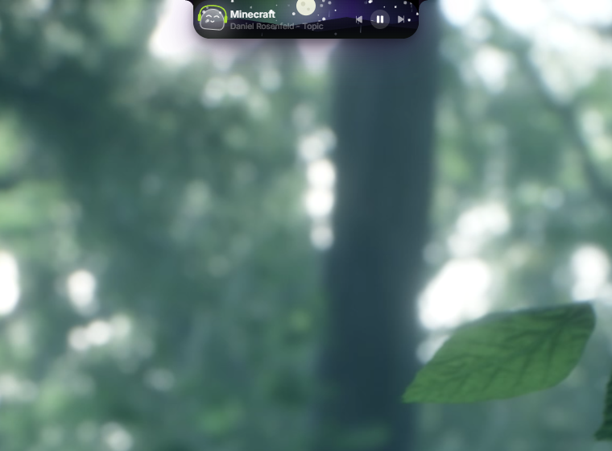
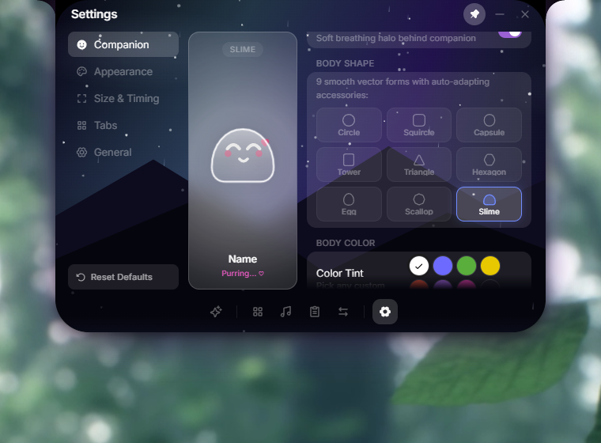
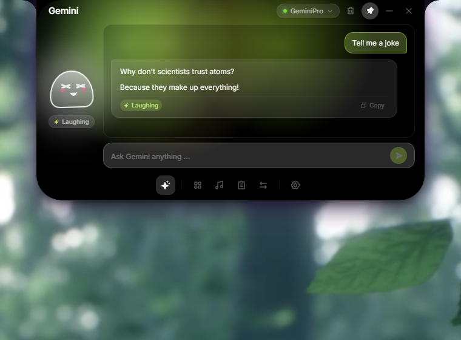
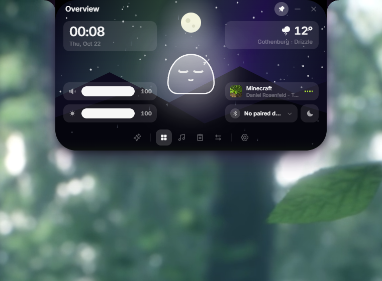

<h1 align="center">Google-Companion Notchbar</h1>

<p align="center">
  <b>A living desktop companion embedded in a fluid Dynamic Island for Windows 10 & 11.</b>
</p>

<p align="center">
  <a href="https://github.com/Screamycat/Google-Companion-Notchbar/releases/latest"></a>
  
  
  <a href="LICENSE"></a>
</p>

<p align="center">
  <a href="#-quick-start--installation"><b>Download</b></a>
  &nbsp;·&nbsp;
  <a href="#-features--tour"><b>Features</b></a>
  &nbsp;·&nbsp;
  <a href="#-controls--gestures-reference"><b>Controls</b></a>
  &nbsp;·&nbsp;
  <a href="#-settings--customization"><b>Customization</b></a>
  &nbsp;·&nbsp;
  <a href="#-frequently-asked-questions-faq"><b>FAQ</b></a>
  &nbsp;·&nbsp;
  <a href="https://github.com/Screamycat/Google-Companion-Notchbar/issues"><b>Roadmap & Issues</b></a>
</p>

---

<p align="center">
  
</p>

---

## What is Google-Companion Notchbar?

**Google-Companion Notchbar** brings an ultra-smooth, fluid **Dynamic Island** to Windows, inhabited by a living, reactive companion that lives discreetly at the top edge of your screen.

Evolved from Linux5Real's original notch concept, this project transforms the static top bezel into an interactive desktop hub:
* **A Living Companion:** An expressive buddy with tactile interactions (head pats, belly tickles, eye-tracking), autonomous idle habits, and a real-time audio DSP engine that makes it put on glowing headphones and groove to your music.
* **Integrated Gemini AI Assistant:** Instant desktop access to Google Gemini models (Flash, Pro, Argon) with companion emotion synchronization, markdown code blocks, and KaTeX mathematical equation rendering.
* **Atmospheric Dynamic World Studio:** Real-time celestial day/night tracking, sun and moon positions, drifting fog, procedural rain, snow, thunder, and wind-blown autumn leaves.
* **Smart Persistent Clipboard:** Multi-type clipboard history capturing text snippets and full-resolution screenshot thumbnails with instant paste and privacy controls.
* **Fluid Spring Physics:** Built on Tauri 2 and 60 FPS spring animations with ultra-low resource usage (~60–80 MB RAM idle).

---

## 3-Stage Fluid Island Architecture

The notch is designed to stay completely out of your way until you need it, morphing across 3 organic stages:

<p align="center">
  
</p>

1. **Stage 1 — Hidden Trigger:** An invisible trigger zone along the top bezel of your primary or secondary display. Zero screen real estate consumed.
2. **Stage 2 — Mini-Island Peek:** Moving your cursor to the top edge expands a sleek, pill-shaped island showing glanceable music playback, current weather, or the companion greeting you.
3. **Stage 3 — Full Workspace Island:** Hovering slightly longer or clicking smoothly unfolds the full modular hub with tool tabs, media controls, and system sliders.

---

## ✨ Features & Tour

### 👾 1. The Living Desktop Companion
Your companion is not a pre-rendered video — it is a procedural, reactive desktop organism:

<p align="center">
  
</p>

* **10 Body Shapes:** Circle, Squircle, Egg, Capsule, Slime, Hexagon, Triangle, Tower, and Scallop.
* **Hats & Eyewear:** Equip cozy Beanies, Halos, Royal Crowns, Caps, Glasses, and Shades.
* **Aura & Colors:** Full 16-million color hex picker with optional ambient aura glow.
* **Tactile Interactions:**
  * **Head Pats:** Gently stroke the top of its head to pet it (features blush cheeks and a purring smile).
  * **Belly Tickles:** Wiggle your cursor back and forth across its body to tickle it with giggling laughter.
  * **Eye Tracking:** Follows cursor motion across your desktop with curious glances.
  * **Autonomous Idle Life:** Yawns, sneezes, snoozes, and reads study books when left alone.
* **Music-Reactive Audio Engine:** Built-in DSP listening directly to Windows audio via WASAPI loopback:
  * Automatically equips glowing headphones during playback.
  * **Level 1 (Chill Sway):** Smooth, relaxed swaying for lo-fi, acoustic, and ambient music.
  * **Level 2 (Hard Groove):** Rhythmic head-bobbing and energized beats for upbeat tracks.
  * **Level 3 (Super Hype):** Intense rock-out mode for bass drops, hardstyle, and energetic choruses.
  * **Tunable Thresholds:** Interactive sliders in Settings let you calibrate exact beat crossover points with live needle meters.

---

### 🤖 2. Google Gemini AI Assistant
Directly accessible from anywhere on Windows via global hotkey (`Alt + A`) or dock tab:

<p align="center">
  
</p>

* **Authenticated WebView2 Session:** Sign in once with your Google Account to unlock your personal Gemini plan (supports Free and Google One AI Premium).
* **Model Switcher:** Toggle on the fly between **Gemini 2.5 Flash**, **Gemini 2.5 Pro**, **Flash-Lite**, and **Argon**.
* **Emotion-Synced Companion:** The companion reacts in real time to the AI's thoughts with 10 expressive physical moods (`[[Thinking]]`, `[[Curious]]`, `[[Vibing]]`, `[[Laughing]]`, `[[Proud]]`, etc.) with calibrated durations (up to 35s for deep thinking).
* **Rich Markdown & Code Highlighting:** Fenced code blocks with language tags and 1-click copy buttons.
* **LaTeX Math Equations (KaTeX):** Full support for inline formulas (`$1/x$`, `$E = mc^2$`) and block mathematical derivations (`$$\int_a^b f(x) dx$$`).
* **Dynamic Auto-Height:** Keeps a minimal 232px footprint, automatically expanding vertically up to ~400px as conversations grow.
* **Reliable Clean Slate:** Clearing the chat reliably resets the underlying session so old contexts never cross-contaminate new questions.

---

### 🌦️ 3. Dynamic World Studio (Atmospheric Engine)
Transform your notch backdrop into an atmospheric living window:

<p align="center">
  
</p>

* **Celestial Simulation:** Real-time solar and lunar tracking calculating exact sun and moon altitudes based on your local clock (Dawn, Day, Sunset, Dusk, Night).
* **Layered Weather Effects:**
  * **Drifting Clouds & Volumetric Fog:** Multi-octave harmonic waves drifting across the notch.
  * **Atmospheric Drizzle & Heavy Rain:** Fluid slanted rain streaks with glass condensation beads and wet puddle reflections.
  * **Audio-Reactive Storms:** Music energy drives rain intensity and triggers procedural lightning flashes!
  * **Falling Snow & Autumn Leaves:** Swirling wind-blown flakes and tumbling maple leaves.
* **Canvas Themes:** Choose between **Dynamic World**, **Audio Reactive Visualizer**, **Cyberpunk Synthwave Neon Grid**, **Aurora Borealis**, or **Minimal Frosted Glass**.

---

### 📋 4. Smart Persistent Clipboard Manager
Never lose copied code, text, or screenshots again:
* **Multi-Format Capture:** Automatically records copied text, code snippets, URLs, and screenshots taken with `Win + Shift + S`.
* **Visual Image Previews:** Screenshot thumbnails with 1-click copy back to clipboard or delete.
* **Persistent Storage:** Saved locally in your user profile so items survive reboots.
* **Memory Safeguards:** Configurable capacity sliders in Settings (maximum items and max images) to prevent memory accumulation.
* **Privacy Purge:** 1-click trash button to wipe clipboard history instantly.

---

### 🎵 5. Media Playback & System Overview
* **Media Control:** Integrates with Windows Media Session (Spotify, YouTube, Chrome, Apple Music, Tidal) with album art, track scrubbers, volume controls, and play/pause/skip.
* **System Overview:** Live clock, auto-IP weather forecast, system volume and display brightness sliders, Bluetooth device battery indicators, and quick Sleep/Lock buttons.

---

### ⌨️ 6. Custom Keybind Recorder & Modular Dock
* **Interactive Shortcut Recorder:** Record any key combination directly from Settings (`Alt + A`, `Ctrl + Win`, `Ctrl + Shift + Space`) to toggle the notch or jump straight to the AI Assistant.
* **Modular Dock Organization:** Reorder tabs via drag-and-drop, toggle visibility, and create grouped dock categories separated by vertical `|` dividers.

---

## 🚀 Quick Start & Installation

### Requirements
* **Operating System:** Windows 10 (version 20H2 or later) or Windows 11 (64-bit).
* **Runtime:** Microsoft Edge WebView2 (pre-installed on Windows 10 & 11).

### 1-Click Install
1. Download the latest installer: [`Google-Companion Notchbar_x.y.z_x64-setup.exe`](https://github.com/Screamycat/Google-Companion-Notchbar/releases/latest).
2. Run the installer. It installs cleanly into your local user directory (`AppData\Local\Programs`) with zero administrative privileges required.
3. The notch will immediately appear at the top of your primary display.

> [!NOTE]
> **Windows SmartScreen Notice:**
> Because this is a newly released, community-driven open-source project without an expensive corporate code-signing certificate, Windows SmartScreen may show an alert on first launch. Click **More info → Run anyway** to proceed.

---

## 🎮 Controls & Gestures Reference

| Action | How to Trigger |
| :--- | :--- |
| **Open Notch** | Move mouse to the top-center edge of the screen, or press your configured global shortcut. |
| **Open AI Assistant** | Press **`Alt + A`** (or your custom recorded hotkey) from any application. |
| **Close Notch** | Move mouse outside the notch window, or press your toggle hotkey again. |
| **Pet Companion** | Slowly stroke your cursor horizontally above its head (purring smile & blush). |
| **Tickle Companion** | Rapidly wiggle your cursor back and forth across its body (giggling dance). |
| **Eye Contact** | Companion eyes autonomously track cursor motion across the open notch. |
| **Pin Notch Open** | Click the pin icon in the top right to keep the island open while working. |
| **Reorder Tabs** | Drag and drop tabs inside **Settings → Tabs**. |

---

## ⚙️ Settings & Customization

Open Settings by clicking the gear icon in the bottom dock:

| Settings Tab | What You Can Tune |
| :--- | :--- |
| **Companion** | Rename buddy, choose from 10 body shapes, hex color palettes, hats, eyewear, smart accessories toggle, and live music groove sliders. |
| **Appearance** | Select background engine (Dynamic World, Audio Visualizer, Aurora, Synthwave), glass transparency, and accent colors. |
| **Size & Timing** | Tune compact peek dimensions, open window size, corner curvatures, hover delay, and mouse sensitivity. |
| **Tabs & Dock** | Reorder tools, assign custom category groups (`|` dividers), and toggle visibility with live preview. |
| **General** | Display monitor selector, Windows autostart toggle, clipboard retention limits, custom hotkey recorder, and in-app updater. |

---

## ❓ Frequently Asked Questions (FAQ)

<details>
<summary><b>How does the Gemini AI session work? Is my account secure?</b></summary>
The AI assistant runs directly through Windows' native WebView2 sandbox connecting to <code>gemini.google.com</code>. Your login credentials are treated exactly like a private browser tab: authentication tokens are stored securely in your local user profile. No tokens, prompts, or personal data ever pass through third-party servers.
</details>

<details>
<summary><b>Does the companion consume CPU/GPU resources while gaming?</b></summary>
When the notch is closed, all canvas rendering, physics loops, and animations stop completely. The background loop uses less than ~0.2% CPU and ~60–80 MB RAM. When you enter an exclusive fullscreen game, the hover trigger can be suppressed so it never interferes with gaming clicks.
</details>

<details>
<summary><b>Can I change which monitor the Notch appears on?</b></summary>
Yes! Open <b>Settings → General → Display</b> to select your preferred monitor (Primary, Secondary, or specific display name), or drag the notch horizontally to offset its position.
</details>

<details>
<summary><b>How do updates work?</b></summary>
Updates are built and signed automatically through GitHub Releases. The app checks once a day in the background (or on demand under Settings). When an update is ready, a notification pill appears with the changelog, allowing 1-click seamless installation.
</details>

---

## 🛠️ Development & Building from Source

Built with modern high-performance desktop technologies:
* **Backend:** [Tauri 2](https://v2.tauri.app/) + [Rust](https://www.rust-lang.org/) (WASAPI loopback audio capture, system tray, global shortcuts, hardware telemetry).
* **Frontend:** [React 19](https://react.dev/), [TypeScript](https://www.typescriptlang.org/), [Tailwind CSS 4](https://tailwindcss.com/).
* **Animation Engine:** [Motion](https://motion.dev/) (physics-based springs).
* **Typesetting:** [KaTeX](https://katex.org/) (LaTeX equation rendering).

### Prerequisites
* [Node.js](https://nodejs.org/) (v20 or later) & npm
* [Rust toolchain](https://www.rust-lang.org/tools/install) (`cargo`, `rustc`)
* Visual Studio Build Tools (C++ development workload)

### Local Setup

```powershell
# 1. Clone repository
git clone https://github.com/Screamycat/Google-Companion-Notchbar.git
cd Google-Companion-Notchbar

# 2. Install dependencies
npm install

# 3. Launch live desktop development with hot-reload
npm run tauri dev

# 4. Typecheck & build production binaries
npm run typecheck
npm run build
```

---

## 🗺️ Roadmap & Upcoming Milestones

Follow our active feature tracking and contribute ideas on our [GitHub Milestones](https://github.com/Screamycat/Google-Companion-Notchbar/milestones):
* 📅 [**Google Calendar Tab**](https://github.com/Screamycat/Google-Companion-Notchbar/milestone/1) — Agenda timeline, countdowns, and 1-click Meet joins.
* 📝 [**Google Keep Notes Tab**](https://github.com/Screamycat/Google-Companion-Notchbar/milestone/2) — Pastel sticky cards and quick capture directly from the notch.
* ✅ [**Google Tasks (ToDo) Tab**](https://github.com/Screamycat/Google-Companion-Notchbar/milestone/3) — Daily checklists with celebratory companion reactions.
* 🏠 [**Google Home & Smart IoT Bridge**](https://github.com/Screamycat/Google-Companion-Notchbar/milestone/4) — Local smart plug and light control.
* 🤖 [**AI Companion Agency**](https://github.com/Screamycat/Google-Companion-Notchbar/milestone/5) — Outfit changes, weather control, and notch tool calling.
* 🎧 [**Smart Music DJ**](https://github.com/Screamycat/Google-Companion-Notchbar/milestone/6) — Automated song recommendation and playback launching.
* 🎮 [**Gaming Mode & Telemetry**](https://github.com/Screamycat/Google-Companion-Notchbar/milestone/7) — Fullscreen game detection and hardware stats.
* 🐧 [**Linux Desktop Support**](https://github.com/Screamycat/Google-Companion-Notchbar/milestone/8) — Cross-platform Wayland & X11 compositing, PipeWire audio, and AppImage/Flatpak packaging.

---

## 📜 License & Acknowledgments

* Licensed under **[GPL-3.0](LICENSE)**. Free and open source for study, modification, and personal use.
* Forked and evolved from [Linux5Real's L4-Windows-NotchBar](https://github.com/Linux5Real/L4-Windows-NotchBar).
